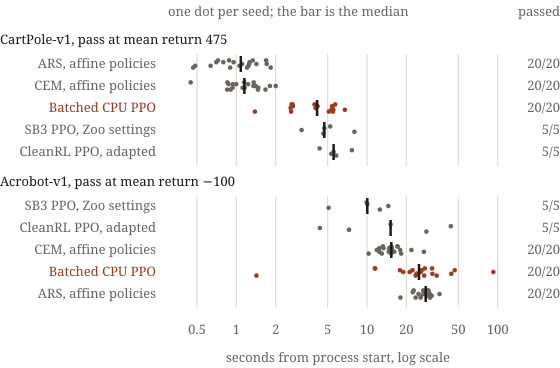

# coldstart

I measure fresh-process time to qualify policies on two small Gymnasium control tasks.

<picture><source media="(prefers-color-scheme: dark)" srcset="docs/figure-dark.svg"></picture>

**Question:** does PPO beat simple policy search once startup and evaluation count?

I built CPU PPO with checked NumPy dynamics, affine-policy ARS/CEM in [`search.py`](control_clock/search.py), and a shared [clock and evaluator](control_clock/protocol.py). The comparators include attributed CleanRL code and Stable-Baselines3 with RL Zoo settings. My separate [JAX PPO comparison](control_clock/jax_ppo.py) follows [Chris Lu's PureJaxRL](https://github.com/luchris429/purejaxrl); its Apache-2.0 license is retained.

**Result:** simple policy search wins CartPole on the laptop; Zoo PPO wins Acrobot. All **140/140 laptop runs** passed. My separate JAX PPO run on an L4 passed **6/6**, but did not improve fresh-process latency with these settings. The [write-up](https://mottopanikeiku.github.io/projects/control-clock/) interprets the result; [`figure.py`](figure.py) draws the figure from [`results/summary.json`](results/summary.json).

## First run

This needs only a CPU: no compiler, GPU or account. It installs locked wheels, then trains ARS on CartPole-v1 seed 0 in one fresh process under the final protocol.

```sh
git clone https://github.com/mottopanikeiku/coldstart && cd coldstart
uv sync --frozen --python 3.12
.venv/bin/python run.py --phase final --task CartPole-v1 --method ars --seeds 0:1 --output results/first-run
```

It prints one line: the record path, `"solved"`, the seconds from process launch to the first passing evaluation, and the stop reason. The record keeps all 100 returns of every evaluation, package versions and the worker command. My published run of this seed passed at 1.69 seconds ([record](results/final/CartPole-v1__ars__default__000.json)); yours depends on your CPU and its load. The policy should not depend on load: seeds fix training and evaluation, and evaluations happen at fixed step counts. A fresh clone on my laptop and the CI runner both reproduced all 800 returns of that record's eight evaluations. That is an observation, not a guarantee: another CPU or library build can round floating-point math differently, and a small difference can change a trajectory.

## Reproduce

The original CPU measurements used an AMD Ryzen AI 5 PRO 340, Fedora Linux 44, and one Torch/BLAS thread ([machine](results/machine.json)). After the install above, this replays the whole laptop plan. Choose a fresh output directory and an otherwise idle CPU.

```sh
nice -n 19 .venv/bin/python measure.py --plan configs/final.json --output results/replication
```

The published records were made with Box2D installed; CartPole and Acrobot never import it. Optional extras add the rest:

| Extra | Adds | Needs |
|---|---|---|
| `box2d` | LunarLander development runs and its equivalence tests | a C++ compiler |
| `jax` | CPU JAX for `tests/test_jax.py` | nothing more |
| `modal` | the client for the paid L4 comparison below | a Modal account |
| `bench` | EnvPool for the systems benchmark (with `jax` for its Gymnax backends) | nothing more |

Install with, for example, `uv sync --frozen --python 3.12 --extra box2d`; repeat `--extra` to combine them. The systems benchmark's C batch is not an extra: `.venv/bin/python -m control_clock.native build` compiles it with the system C compiler, and without it everything uses the NumPy batch. [Run notes](docs/RUNNING.md) cover summaries, settings, attribution, failed development trials and correctness checks.

## Original laptop results

Seconds from Python process launch through the first passing evaluation, including imports, construction, first-use work and **every evaluation**. Medians and interquartile intervals are among successes; fractions include all planned seeds. [`results/summary.json`](results/summary.json) links all raw records.

| Task | Method | Median seconds [Q1, Q3] | Solved |
|---|---|---:|---:|
| CartPole-v1 | ARS, affine policies | **1.08 [0.78, 1.28]** | 20/20 |
| CartPole-v1 | CEM, affine policies | 1.15 [0.93, 1.42] | 20/20 |
| CartPole-v1 | Batched CPU PPO | 4.15 [2.71, 5.46] | 20/20 |
| CartPole-v1 | SB3 PPO, Zoo settings | 4.72 [4.64, 5.23] | 5/5 |
| CartPole-v1 | CleanRL PPO, adapted | 5.55 [5.33, 5.81] | 5/5 |
| Acrobot-v1 | SB3 PPO, Zoo settings | **10.05 [9.94, 12.52]** | 5/5 |
| Acrobot-v1 | CleanRL PPO, adapted | 15.15 [7.28, 28.49] | 5/5 |
| Acrobot-v1 | CEM, affine policies | 15.34 [13.18, 17.11] | 20/20 |
| Acrobot-v1 | Batched CPU PPO | 25.01 [20.64, 31.52] | 20/20 |
| Acrobot-v1 | ARS, affine policies | 28.15 [25.48, 29.90] | 20/20 |

Passing means raw mean return **475 or higher on CartPole, -100 or higher on Acrobot**, over **100 complete greedy Gymnasium episodes**. Evaluation seeds are disjoint from training. Limits are 120/300 seconds. Initial random policies count too, so this is qualification time, not necessarily time spent learning ([protocol](docs/PROTOCOL.md)).

## Where the seconds go: systems benchmark

I split the clock for my three methods and measured six environment backends on their own, in an exclusive window on one pinned Zen 5 core ([details](docs/SYSTEMS.md), [raw data](results/bench)). Every backend first passed an equivalence gate against Gymnasium. In this run, the fused Gymnax rows shared the unfused Gymnax gate; I added and ran a fused-path check afterwards. All 30 pinned reruns reproduced their published evaluations exactly, and the measured phases account for each run to within 0.05%. Later I added a seventh backend, a C version of my batches, and timed it against my NumPy batch in a second window.

- **Evaluation is the largest cost.** It took 64–81% of the solve clock for ARS and CEM on both tasks and for PPO on Acrobot. The environment step took 2–26%. For PPO on CartPole, optimizer epochs took 47% and Torch import plus setup took 26%.
- **My NumPy Acrobot batch is fast at large batches.** At 4,096 environments it ran 3.84 M transitions/s, against 0.028 M/s for Gymnasium and 1.53 M/s for one-thread EnvPool. Gymnax was faster, at 6.06 M/s, after a 0.4–0.8 s compile.
- **My NumPy CartPole batch is reset-bound.** Gymnasium's own vectorized CartPole ran 28.2 M/s at 4,096; mine ran 3.07 M/s. Seeding each reset exactly like Gymnasium took 90% of my batch's time at that size.
- **My C batch is 7.7–13× faster on CartPole.** I wrote CartPole and Acrobot again in plain C, loaded through ctypes. One call resets any set of slots and matches Gymnasium's per-seed resets bit for bit on 1,010,006 seeds per task. Its steps match my NumPy batch bit for bit on every tested trace. In the second window it ran 7.7–13× faster than my NumPy batch on CartPole, reaching 41.3 M/s at 4,096, and 1.5–35× faster on Acrobot ([details](docs/SYSTEMS.md#a-fused-c-batch)).
- **The environment is 22–27% of an ARS or CEM run.** Environment steps and resets took that share of the median run of each configuration, and 2–3% of a PPO run. So even an environment that took no time would cut qualification by at most about a fifth to a quarter. The protocol still uses the NumPy batch, and I did not time the C batch inside a qualification run.
- **Qualified policies are near the bar.** Replayed in a new process, all 30 saved policies matched their recorded actions. On 1,000 fresh episodes never used for selection, 26 of 30 still passed. On Acrobot, only 31–37 of each method's 50 fresh 100-episode blocks passed, pooled over five policies.

## Separate implementation and hardware comparison: JAX PPO on an L4

I ran JAX-vectorized PPO with Gymnax training on a **Modal NVIDIA L4**, requesting two host CPU cores and 4 GiB RAM. The evaluator, thresholds and time limits are unchanged. **Python imports, CUDA initialization, JIT compilation and all evaluations stay on the process clock.** At checkpoints I copy weights to the host and evaluate the greedy policy in actual Gymnasium.

| Task | JAX PPO median seconds [Q1, Q3] | Solved |
|---|---:|---:|
| CartPole-v1 | 26.38 [25.99, 33.77] | 3/3 |
| Acrobot-v1 | 97.43 [80.20, 126.36] | 3/3 |

Source: [`results/gpu/summary.json`](results/gpu/summary.json), [six raw runs](results/gpu/final). I changed hardware, training backend and PPO settings together: this does **not** isolate a GPU speedup or measure already-compiled throughput.

Gymnax's default dynamics match within stated tolerances, with precision, PRNG, timeout and wrapping differences documented in [environment notes](docs/ENVIRONMENTS.md#gymnax-training-in-the-separate-l4-comparison).

Replicating it is **paid**: it bills a Modal account already authenticated with `modal setup`, but needs no local GPU. My conservative estimate for the whole comparison, including two failed setup attempts, was $0.37 ([cost](results/gpu/cost.json)). No new laptop timings were used for it.

```sh
uv sync --frozen --python 3.12 --extra modal
.venv/bin/modal run modal_app.py --phase final --output results/gpu-replication
```

## Limits

- The fixed evaluation set is reused for stopping and development selection, not held out. The pinned reruns of seeds 0–4 reproduced their published evaluations exactly, so their saved policies are those runs' winners. On fresh episodes, some fall below the bar ([systems benchmark](docs/SYSTEMS.md#saved-policies-and-a-fresh-evaluation-cohort)). Seeds 5–19 and the library runs have no saved policy yet.
- Two small tasks, one laptop and three GPU seeds per task do not establish a general ranking.
- Objectives, normalization, checkpoint grids and training horizons differ between methods.
- Dynamics are tolerance-checked, not bitwise identical; OS/driver caches and cloud CPU placement are not controlled.
- LunarLander's isolated final cohort remains **not run**; only development attempts exist.

## Prior work

[Gymnasium](https://gymnasium.farama.org/), [Gymnax](https://github.com/RobertTLange/gymnax), [PureJaxRL](https://github.com/luchris429/purejaxrl), [Stable-Baselines3](https://github.com/DLR-RM/stable-baselines3), [RL Baselines3 Zoo](https://github.com/DLR-RM/rl-baselines3-zoo), [CleanRL](https://github.com/vwxyzjn/cleanrl), [Mania, Guy and Recht's ARS](https://arxiv.org/abs/1803.07055), and [Rubinstein's cross-entropy method](https://doi.org/10.1023/A:1010091220143).

Written with AI coding assistance.
