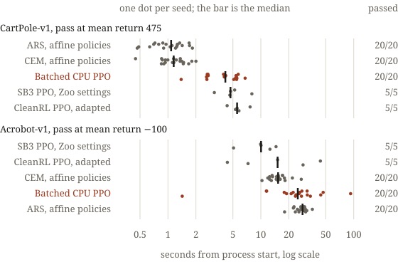

# coldstart

Random search gets a passing CartPole policy in about a second from a cold Python start; PPO takes 4–6 seconds. I timed PPO, augmented random search (ARS) and the cross-entropy method (CEM) on my laptop, with imports, training and every evaluation on the clock.

<picture><source media="(prefers-color-scheme: dark)" srcset="docs/figure-dark.svg"></picture>

## Try it

With [uv](https://docs.astral.sh/uv/) installed, these three commands train ARS on CartPole. The install uses locked CPU wheels; no compiler or GPU is needed.

```sh
git clone https://github.com/mottopanikeiku/coldstart && cd coldstart
uv sync --frozen --python 3.12
.venv/bin/python run.py --phase final --task CartPole-v1 --method ars --seeds 0:1 --output results/first-run
```

The command prints `"solved": true`, the elapsed seconds and the result path. The JSON contains all 100 episode returns from each evaluation, the settings and a saved policy. Choose a different output directory to run it again; existing results are never overwritten. Timing depends on your CPU and its load.

## Laptop results

ARS wins CartPole at **1.08 seconds** median. SB3 PPO with RL Zoo settings wins Acrobot at **10.05 seconds**. All **140/140 runs passed**.

Median seconds from Python launch through the first passing evaluation, on an AMD Ryzen AI 5 PRO 340 running Fedora 44 with one Torch/BLAS thread:

| Method | CartPole-v1 | Acrobot-v1 | Passed, per task |
|---|---:|---:|---:|
| ARS, affine policy | 1.08 | 28.15 | 20/20 |
| CEM, affine policy | 1.15 | 15.34 | 20/20 |
| Batched CPU PPO | 4.15 | 25.01 | 20/20 |
| SB3 PPO, Zoo settings | 4.72 | 10.05 | 5/5 |
| CleanRL PPO, adapted | 5.55 | 15.15 | 5/5 |

The [summary](results/summary.json) includes quartiles and links to every run. [`figure.py`](figure.py) draws the figure from it. [Baseline settings](docs/BASELINES.md) and [development experiments](docs/DEVELOPMENT.md) explain the configurations.

## Where the time goes

I profiled five seeds per task for ARS, CEM and my PPO, pinned to one Zen 5 core:

- Gymnasium evaluation takes **64–81%** of the run for ARS and CEM on both tasks and PPO on Acrobot. CartPole PPO spends 47% in optimizer updates and another 26% on imports and setup.
- Training-environment steps and resets take **22–27%** of an ARS or CEM run, and 2–3% of a PPO run. Even free environment simulation would leave most of the wait.
- My optional C batch runs CartPole **7.7–13× faster** than the NumPy batch, reaching 41.3 million transitions/s at batch size 4,096. Its resets match Gymnasium bit for bit on **1,010,006 seeds per task**. The qualification runs above use NumPy; I have only timed C as a separate environment benchmark.

The [systems measurements](docs/SYSTEMS.md) include backend throughput, imports, evaluation costs and policy replay. The [environment notes](docs/ENVIRONMENTS.md) cover the C implementation and numerical checks.

## What counts as passing

Every method evaluates greedy actions in actual Gymnasium for 100 complete episodes. The mean raw return must reach 475 on CartPole or −100 on Acrobot. Evaluation seeds are separate from training seeds.

The clock starts immediately before launching Python and stops when the first passing evaluation finishes. It includes imports, construction, training and all earlier evaluations. Installation, saving the policy and process teardown are outside the clock. An initial random policy can pass too: two PPO seeds did.

Evaluation runs before training, then after completed updates at intervals of at least 10,000 training transitions. CartPole gets 120 seconds per seed; Acrobot gets 300. The [protocol](docs/PROTOCOL.md) specifies the seeds, deadlines and summary statistics.

To repeat all 140 laptop runs on an otherwise idle CPU:

```sh
nice -n 19 .venv/bin/python measure.py --plan configs/final.json --output results/replication
```

[Run instructions](docs/RUNNING.md) cover tests, optional dependencies, summaries and the separate JAX PPO comparison on an L4. That comparison passed all six runs but took longer: 26.38 seconds median on CartPole and 97.43 on Acrobot ([results](results/gpu/summary.json)).

## What this comparison leaves open

- The fixed evaluation set is reused for stopping and configuration selection. On 1,000 new episodes per saved policy, 26/30 still passed; the replay covers five seeds of my three methods.
- These are two small tasks on one laptop. The library PPO samples have five seeds per task, and methods differ in normalization, networks, checkpoint spacing and training horizons.
- A cold Python process can still read warm OS caches. Other CPUs and library builds can produce different floating-point trajectories and timings.
- The L4 run changes hardware, training backend and PPO settings together. LunarLander has development attempts only.

## Built on

[Gymnasium](https://gymnasium.farama.org/), [Stable-Baselines3](https://github.com/DLR-RM/stable-baselines3), [RL Baselines3 Zoo](https://github.com/DLR-RM/rl-baselines3-zoo), [CleanRL](https://github.com/vwxyzjn/cleanrl), [Gymnax](https://github.com/RobertTLange/gymnax) and [PureJaxRL](https://github.com/luchris429/purejaxrl). Algorithm references and attribution are in [prior work](docs/PRIOR_WORK.md).
